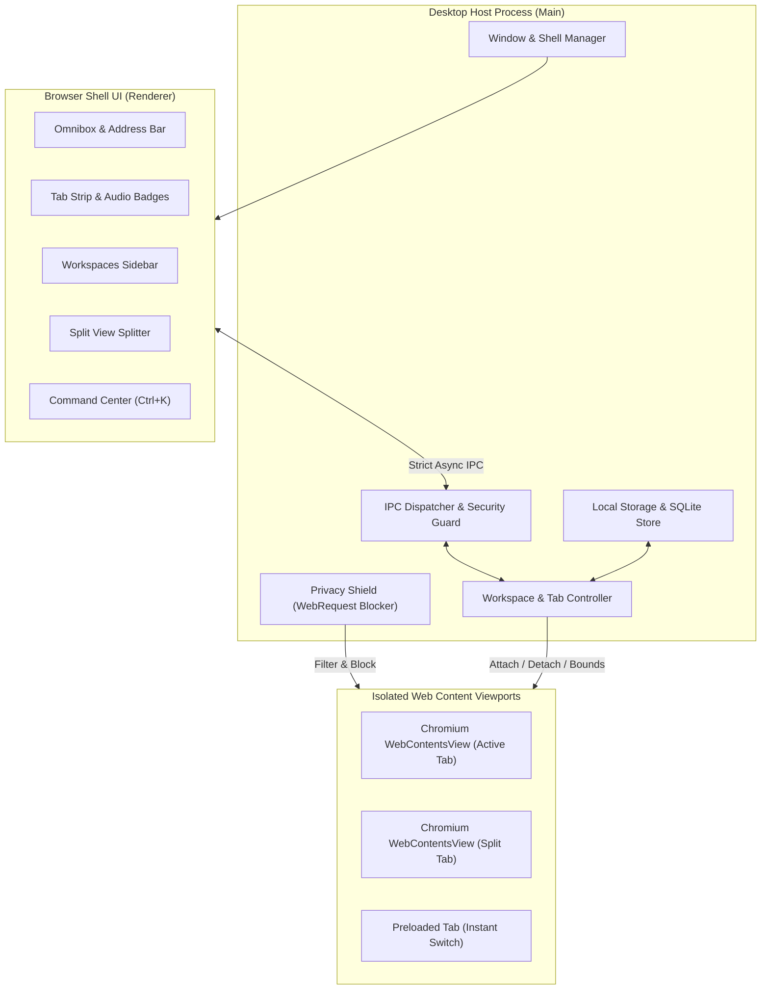

# Vibez Browser — Technical Architecture

Vibez Browser is engineered with a modular, multi-process architecture based on the Chromium runtime. It separates the native desktop shell and window management from the untrusted web content processes, strictly enforcing Chromium's security sandbox.

---

## 1. High-Level System Architecture



---

## 2. Process & Security Boundary Model

| Process | Context | Permissions | Description |
| :--- | :--- | :--- | :--- |
| **Main Process** | Node.js + Native OS | Full OS access, Windowing, Network Hooks | Manages native window lifecycle, manages `WebContentsView` instances, intercepts network traffic via `session.defaultSession.webRequest`, handles disk persistence. |
| **Shell UI Renderer** | Sandboxed Chromium | Zero Node.js, Zero direct OS access | Renders browser chrome (tabs, URL bar, sidebars, command center). Communicates exclusively via typed IPC calls exposed in a hardened preload script. |
| **Web Content Viewports** | Sandboxed Chromium Renderers | Isolated Web Sandboxes | Untrusted external web content. Node.js is completely disabled, context isolation is enforced, site isolation is active. |

---

## 3. Core Subsystems

### 3.1 Privacy Shield Engine
The Privacy Shield intercepts every HTTP/HTTPS request before it leaves the browser using Chromium's `webRequest.onBeforeRequest` hook:
1. **Rule Evaluation**: Requests are matched against categorized blocklists (EasyList, Peter Lowe's Ad Servers, EasyPrivacy trackers, CoinMiner filters).
2. **Action Dispatch**:
   - `cancel: true`: Drops the request completely if blocked.
   - `redirectURL`: Redirects tracking beacons to local 1x1 transparent SVG/GIF data URIs to avoid breaking page layout.
3. **Telemetry & Shield Drawer**: Blocked counters are aggregated per origin and streamed back to the Shell UI's Shield Popup in real time.
4. **Site Whitelisting**: If a user disables shields for a domain, its rules are bypassed instantly for that origin.

### 3.2 Workspace & Tab State Model
Workspaces partition browser tabs into independent virtual desks:
```typescript
interface Workspace {
  id: string;              // e.g. "ws-dev-01"
  name: string;            // e.g. "Dev & Cloud"
  icon: string;            // e.g. "terminal"
  color: string;           // Hex theme accent
  tabs: TabState[];        // Ordered list of tab objects
  activeTabIndex: number;  // Currently active tab
  splitTabId?: string;     // Secondary tab in Split View (optional)
}

interface TabState {
  id: string;
  url: string;
  title: string;
  favicon?: string;
  isLoading: boolean;
  canGoBack: boolean;
  canGoForward: boolean;
  isMuted: boolean;
  isPinned: boolean;
}
```

### 3.3 Split View Coordinator
- In single-view mode, the active `WebContentsView` occupies the full viewport below the top chrome:
  `{ x: sidebarWidth, y: topBarHeight, width: windowWidth - sidebarWidth, height: windowHeight - topBarHeight }`
- In Split View mode:
  - Left pane: `width = (availableWidth * splitRatio) - (dividerWidth / 2)`
  - Right pane: `width = (availableWidth * (1 - splitRatio)) - (dividerWidth / 2)`
  - Draggable divider adjusts `splitRatio` (clamped between 0.20 and 0.80).
  - Focus switching: Clicking either pane activates its URL in the primary or secondary address bar.

### 3.4 Command Center (`Ctrl+K`)
- An overlay floating palette rendered in the shell UI.
- Fuzzy matching algorithm searches:
  1. `tabs`: Search open tabs across all workspaces (immediate workspace jump).
  2. `actions`: Search browser commands (`New Window`, `Split View`, `Clear Data`, `Toggle Shield`, etc.).
  3. `history` & `bookmarks`: Search saved items.
  4. `web`: Direct query to default search engine.

---

## 4. Data Persistence & Storage Architecture

All data is stored locally in the user application data directory:
`%APPDATA%/VibezBrowser/` (Windows) or `~/.config/VibezBrowser/` (Linux/macOS):
- `workspaces.json`: Workspaces, open tabs, and split configurations.
- `history.json`: Timestamped URL navigation records with title and visit count.
- `bookmarks.json`: Structured bookmark tree.
- `shield_settings.json`: Per-site shield overrides and global blocking mode.
- `preferences.json`: Window dimensions, theme, default search engine, and keyboard bindings.
