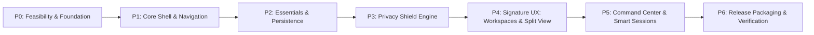

# Vibez Browser — Development Phases & Implementation Roadmap

This document outlines the step-by-step development strategy for **Vibez Browser**, from initial scaffolding through public V1 desktop release and V2 roadmap expansion.

---

## Roadmap Overview

---

## Detailed Phases

### Phase P0: Feasibility & Foundation
- [x] Establish project workspace and Git repository at `C:\Users\devFiend\Desktop\Web Dev Projects\VIBEZ_BROWSER`.
- [x] Author comprehensive documentation suite (`PRD.md`, `ARCHITECTURE.md`, `INDEX.md`, etc.).
- [ ] Initialize Node / Electron Chromium project configuration (`package.json`, TypeScript / JS setup).
- [ ] Build baseline frameless desktop window with custom titlebar, min/max/close controls, and DPI scaling.
- [ ] Implement secure IPC bridge with context isolation and hardened preload APIs.

### Phase P1: Core Shell & Navigation
- [ ] Dynamic Tab Strip: Tab creation, selection, reordering, closing, audio status indicators, and favicon rendering.
- [ ] Unified Omnibox:
  - Smart URL detection (e.g. `github.com` vs search query).
  - Search engine resolver (Google default, plus Bing, DuckDuckGo, Brave Search).
  - Navigation controls: Back, Forward, Reload, Stop, Home.
- [ ] WebContentsView lifecycle management:
  - Safe tab allocation, viewport resizing, background tab freezing/throttling.
  - Page loading progress bar and SSL security certificate badge.

### Phase P2: Browser Essentials & Local Storage
- [ ] History Manager:
  - Chronological visit recording (URL, title, timestamp, favicon).
  - History view modal / panel with search and selective deletion.
- [ ] Bookmarks Bar & Manager:
  - Add/remove bookmark button in omnibox.
  - Hierarchical folder storage and quick-access bookmarks strip.
- [ ] Downloads Manager:
  - Download shelf / notification with live byte progress, pause, cancel, and reveal in explorer.
- [ ] Error Pages & Offline Fallback:
  - Clean, dark-mode offline and connection failure screens.

### Phase P3: Privacy Shield Engine
- [ ] Request Interception Subsystem (`onBeforeRequest`):
  - Ingestion and compilation of ad/tracker domain blocklists.
  - Fast hash-set and regex matching for tracker domains, beacons, and telemetries.
- [ ] Live Counter & Per-Site Controls:
  - Shield popup drawer showing blocked count, tracker list, and toggle switch.
  - Per-site whitelist stored in `shield_settings.json`.
- [ ] Cookie and Fingerprint Defenses:
  - Third-party tracking cookie blocking.
  - Referrer header trimming on cross-origin navigations.

### Phase P4: Signature UX — Workspaces & Native Split View
- [ ] Workspaces Subsystem:
  - Left navigation rail with workspace icons and active indicator.
  - Workspace creation dialog (Name, Color, Icon).
  - Complete tab separation per workspace with instant zero-lag switching.
- [ ] Native Split View Subsystem:
  - Side-by-side dual `WebContentsView` layout.
  - Draggable center split divider with smooth drag resize.
  - Dual omnibox / focused pane indicator.
  - One-click swap panes and unsplit actions.

### Phase P5: Command Center (`Ctrl+K`) & Smart Sessions
- [ ] Command Center Palette:
  - Global `Ctrl+K` invocation.
  - Fuzzy matcher searching open tabs (cross-workspace), history, bookmarks, and commands.
  - Keyboard navigation (Arrow keys, Enter, Esc).
- [ ] Smart Sessions Engine:
  - Automatic session state persistence on tab changes and window events.
  - Clean session restoration upon restart.
  - Named session snapshots (export/import session file).

### Phase P6: Verification, Testing & Windows Distribution
- [ ] Comprehensive unit and integration test suite (IPC, ad-blocker benchmark, session store).
- [ ] Windows installer build setup (`electron-builder` NSIS setup, portable executable).
- [ ] Zero-telemetry audit: Verify network activity is 100% user-directed.
- [ ] GitHub repository publication and user documentation.
