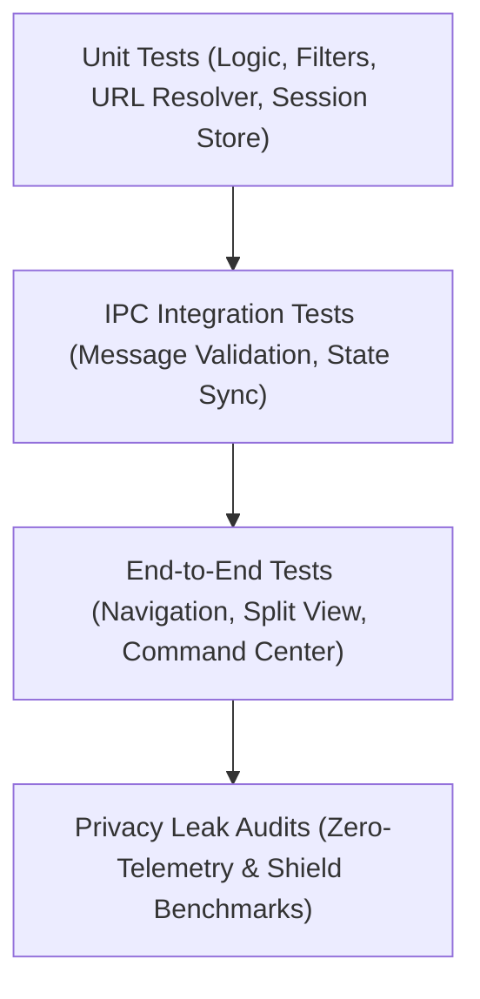

# Vibez Browser — Testing Strategy & Quality Assurance

This document details the testing architecture, quality criteria, and automated verification protocols for Vibez Browser.

---

## 1. Testing Pyramid

---

## 2. Test Suites

### 2.1 Unit Tests
- **URL Resolver**: Verifies string inputs correctly resolve to full HTTPS URLs or search queries (e.g. `github.com` -> `https://github.com`, `react docs` -> search query).
- **Privacy Shield Filter**: Tests blocking against 1,000+ known ad/tracker domains, verifying zero false blocks on top 50 developer/documentation portals.
- **Session Persistence**: Validates that workspace arrays, active tabs, and split states serialize and deserialize without data loss or corruption.
- **Command Center Fuzzy Search**: Tests accuracy of ranking and speed across 500+ mock tabs and history items.

### 2.2 Integration Tests
- **Multi-Process IPC**: Validates message serialization, timeout handling, and context isolation between main process and renderer.
- **Split View Synchronization**: Ensures left and right viewports properly report active URL changes and resize smoothly without tearing.
- **Workspace State Isolation**: Confirms tabs in Workspace A never bleed into Workspace B.

### 2.3 Privacy & Network Audit
- Run browser with automated network sniffer (proxy/mock):
  - Ensure zero telemetry packets sent to external endpoints on startup.
  - Verify blocked ad requests are dropped before leaving the socket layer.
